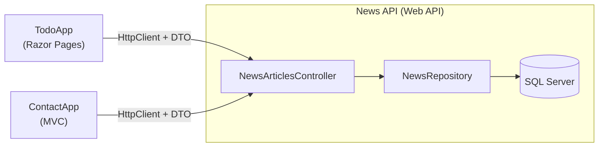

# ApiConsume-Architecture

Bir **ASP.NET Core Web API**'nin, iki ayrı full-stack web uygulaması tarafından **HttpClient** ve **DTO**'lar aracılığıyla tüketildiği çok projeli bir .NET 9 çözümü.

Çözüm üç projeden oluşur:

| Proje | Tür | Açıklama |
|---|---|---|
| **News** | ASP.NET Core Web API | Haberlerin yönetildiği RESTful API |
| **TodoApp** | ASP.NET Core Razor Pages | Görev takip uygulaması + API'den gelen haberler |
| **ContactApp** | ASP.NET Core MVC | Rehber (kişi yönetimi) uygulaması + API'den gelen haberler |

## 🏗️ Mimari



İki istemci uygulama da API'ye doğrudan veritabanı üzerinden değil, HTTP istekleriyle bağlanır. API'den gelen JSON verisi, her uygulamanın kendi `NewsArticleDto` sınıfına dönüştürülür. Böylece uygulamalar API'nin iç yapısına bağımlı olmaz.

## 📰 News API

Haberler için CRUD işlemleri sunan RESTful API.

| Metot | Uç nokta | Açıklama | Başarılı yanıt |
|---|---|---|---|
| `GET` | `/api/NewsArticles` | Tüm haberleri listeler (yayın tarihine göre yeniden eskiye) | `200 OK` |
| `GET` | `/api/NewsArticles/{id}` | Tek bir haberi getirir | `200 OK` / `404 Not Found` |
| `POST` | `/api/NewsArticles` | Yeni haber ekler | `201 Created` |
| `PUT` | `/api/NewsArticles/{id}` | Haberi günceller | `204 No Content` |
| `DELETE` | `/api/NewsArticles/{id}` | Haberi siler | `204 No Content` |

Her haberde başlık, benzersiz URL kısaltması (slug), özet, içerik, yayın tarihi, yazar ve yayın durumu (`Draft` / `Published` / `Archived`) bulunur.

**Öne çıkanlar:**
- Repository Pattern ve Dependency Injection ile katmanlı yapı
- Entity Framework Core (Code-First): migration'lar, Fluent API konfigürasyonu ve seed data
- Slug alanı için unique index
- Model doğrulama ve uygun HTTP durum kodları (`201`, `204`, `400`, `404`)
- `CancellationToken` destekli asenkron işlemler
- Swagger ile API dokümantasyonu
- Uygulama başlarken bekleyen migration'ların otomatik uygulanması

## ✅ TodoApp

- Görev ekleme, listeleme, düzenleme ve silme (CRUD)
- Görevlere öncelik (Düşük / Orta / Yüksek), son tarih ve tamamlanma durumu
- **FluentValidation** ile doğrulama (ör. son tarih geçmiş bir tarih olamaz)
- `ITodoStore` arayüzü sayesinde değiştirilebilir veri katmanı: geliştirme ortamında bellek içi depolama, Production ortamında SQL Server (EF Core)
- `/News` sayfasında News API'den gelen haberlerin listesi ve detayı

## 📇 ContactApp

- Kişi ekleme, listeleme, düzenleme ve silme (CRUD)
- SQLite + EF Core ile kalıcı veri saklama
- Data Annotations ve jQuery Validation ile istemci ve sunucu taraflı doğrulama
- `/news` sayfasında News API'den gelen haberlerin listesi ve detayı
- API'ye ulaşılamadığında uygulamanın çökmemesi için hata yakalama ve loglama

Ayrıntılar için: [ContactApp/README.md](ContactApp/README.md)

## 🛠️ Teknolojiler

- .NET 9, C#
- ASP.NET Core Web API, MVC, Razor Pages
- Entity Framework Core (SQL Server, SQLite)
- Swagger (Swashbuckle)
- FluentValidation
- Bootstrap 5

## 🚀 Çalıştırma

**Gereksinimler:** .NET 9 SDK, SQL Server LocalDB (Visual Studio ile birlikte gelir)

### Visual Studio ile

1. `ApiConsume.slnx` dosyasını açın.
2. Çözüme sağ tıklayın → **Configure Startup Projects** → **Multiple startup projects** seçin.
3. `News`, `TodoApp` ve `ContactApp` projelerinin üçünü de **Start** olarak ayarlayın.
4. **https** profiliyle çalıştırın.

### Komut satırı ile

Her projeyi ayrı bir terminalde çalıştırın. **News API önce başlatılmalıdır**, çünkü diğer iki uygulama haberleri ondan alır.

```bash
dotnet run --project News --launch-profile https
dotnet run --project TodoApp --launch-profile https
dotnet run --project ContactApp --launch-profile https
```

Veritabanları ilk çalıştırmada otomatik olarak oluşturulur ve örnek verilerle doldurulur.

### Adresler

| Proje | Adres |
|---|---|
| News API (Swagger) | https://localhost:7080/swagger |
| TodoApp | https://localhost:7226 |
| ContactApp | https://localhost:7168 |

İstemci uygulamaların bağlandığı API adresi `appsettings` dosyalarından değiştirilebilir (`TodoApp`: `NewsApi:BaseUrl`, `ContactApp`: `ApiBaseUrl`).

## 📁 Proje Yapısı

```
ApiConsume-Architecture/
├── News/                 # Web API
│   ├── Controllers/      # NewsArticlesController
│   ├── Models/           # NewsArticle, NewsStatus
│   ├── Repositories/     # INewsRepository, NewsRepository, NewsDbContext, Config/
│   └── Migrations/
├── TodoApp/              # Razor Pages
│   ├── Pages/            # Todos/, News/
│   ├── Services/         # ITodoStore, NewsApi/ (NewsClient, NewsArticleDto)
│   ├── Validators/       # TodoValidator (FluentValidation)
│   └── Repositories/
└── ContactApp/           # MVC
    ├── Controllers/      # ContactsController, NewsController
    ├── Services/         # NewsService
    ├── Contracts/DTOs/   # NewsArticleDto
    ├── Repositories/
    └── Views/
```
