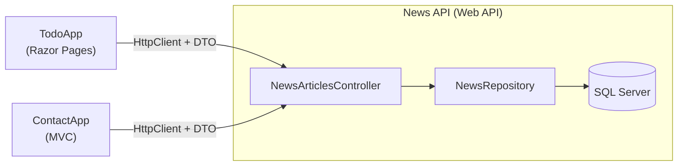

# ApiConsume-Architecture

A multi-project .NET 9 solution in which an **ASP.NET Core Web API** is consumed by two separate full-stack web applications through **HttpClient** and **DTOs**.

The solution consists of three projects:

| Project | Type | Description |
|---|---|---|
| **News** | ASP.NET Core Web API | RESTful API for managing news articles |
| **TodoApp** | ASP.NET Core Razor Pages | Task tracking app + news from the API |
| **ContactApp** | ASP.NET Core MVC | Contact management app + news from the API |

## 🏗️ Architecture



Both client applications connect to the API over HTTP rather than accessing its database directly. The JSON returned by the API is mapped to each application's own `NewsArticleDto` class, so the clients do not depend on the API's internal models.

## 📰 News API

A RESTful API that provides CRUD operations for news articles.

| Method | Endpoint | Description | Success response |
|---|---|---|---|
| `GET` | `/api/NewsArticles` | Lists all articles (newest first by publish date) | `200 OK` |
| `GET` | `/api/NewsArticles/{id}` | Returns a single article | `200 OK` / `404 Not Found` |
| `POST` | `/api/NewsArticles` | Creates a new article | `201 Created` |
| `PUT` | `/api/NewsArticles/{id}` | Updates an article | `204 No Content` |
| `DELETE` | `/api/NewsArticles/{id}` | Deletes an article | `204 No Content` |

Each article has a title, a unique URL slug, a summary, content, a publish date, an author and a publication status (`Draft` / `Published` / `Archived`).

**Highlights:**
- Layered structure with the Repository Pattern and Dependency Injection
- Entity Framework Core (Code-First): migrations, Fluent API configuration and seed data
- Unique index on the slug field
- Model validation and appropriate HTTP status codes (`201`, `204`, `400`, `404`)
- Asynchronous operations with `CancellationToken` support
- API documentation with Swagger
- Pending migrations are applied automatically on startup

## ✅ TodoApp

- Create, list, edit and delete tasks (CRUD)
- Task priority (Low / Medium / High), due date and completion status
- Validation with **FluentValidation** (e.g. the due date cannot be in the past)
- Swappable data layer through the `ITodoStore` interface: in-memory storage in Development, SQL Server (EF Core) in Production
- `/News` page that lists articles from the News API and shows their details

## 📇 ContactApp

- Create, list, edit and delete contacts (CRUD)
- Persistent storage with SQLite + EF Core
- Client-side and server-side validation with Data Annotations and jQuery Validation
- `/news` page that lists articles from the News API and shows their details
- Error handling and logging so the app keeps working when the API is unreachable

For more details, see [ContactApp/README.md](ContactApp/README.md).

## 🛠️ Tech Stack

- .NET 9, C#
- ASP.NET Core Web API, MVC, Razor Pages
- Entity Framework Core (SQL Server, SQLite)
- Swagger (Swashbuckle)
- FluentValidation
- Bootstrap 5

## 🚀 Getting Started

**Prerequisites:** .NET 9 SDK, SQL Server LocalDB (included with Visual Studio)

### With Visual Studio

1. Open `ApiConsume.slnx`.
2. Right-click the solution → **Configure Startup Projects** → select **Multiple startup projects**.
3. Set `News`, `TodoApp` and `ContactApp` to **Start**.
4. Run with the **https** profile.

### From the command line

Run each project in a separate terminal. **Start the News API first**, since the other two applications fetch news from it.

```bash
dotnet run --project News --launch-profile https
dotnet run --project TodoApp --launch-profile https
dotnet run --project ContactApp --launch-profile https
```

The databases are created and filled with sample data automatically on first run.

### URLs

| Project | URL |
|---|---|
| News API (Swagger) | https://localhost:7080/swagger |
| TodoApp | https://localhost:7226 |
| ContactApp | https://localhost:7168 |

The API address used by the client applications can be changed in their `appsettings` files (`TodoApp`: `NewsApi:BaseUrl`, `ContactApp`: `ApiBaseUrl`).

## 📁 Project Structure

```
ApiConsume-Architecture/
├── News/                 # Web API
│   ├── Controllers/      # NewsArticlesController
│   ├── Models/           # NewsArticle, NewsStatus
│   ├── Repositories/     # INewsRepository, NewsRepository, NewsDbContext, Config/
│   └── Migrations/
├── TodoApp/              # Razor Pages
│   ├── Pages/            # Todos/, News/
│   ├── Services/         # ITodoStore, NewsApi/ (NewsClient, NewsArticleDto)
│   ├── Validators/       # TodoValidator (FluentValidation)
│   └── Repositories/
└── ContactApp/           # MVC
    ├── Controllers/      # ContactsController, NewsController
    ├── Services/         # NewsService
    ├── Contracts/DTOs/   # NewsArticleDto
    ├── Repositories/
    └── Views/
```
